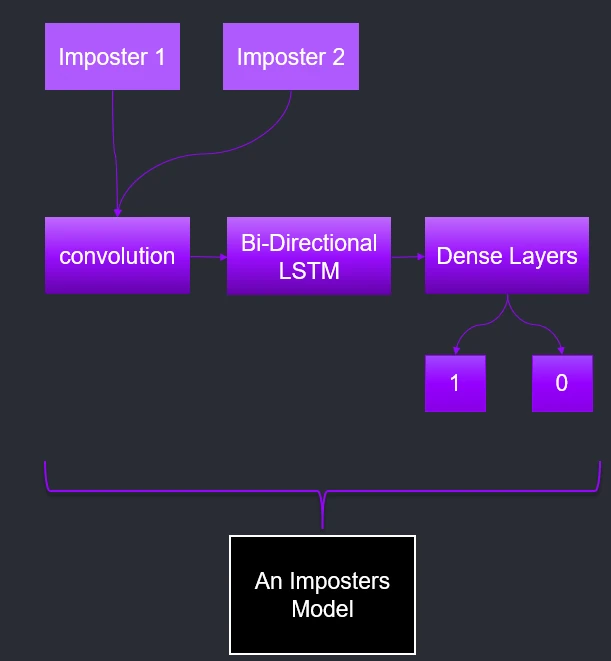
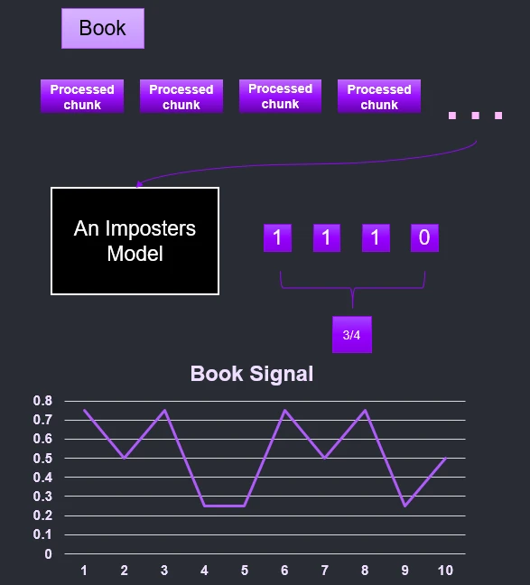

# Arabic author verification: the data-processing step of my M.Sc. final project


Software that compares writing styles to check whether an ancient Arabic book was really written by the author whose name
is on it. It was my M.Sc. final project in Software Engineering (AI and NLP) at Braude Academic College, 2021 to 2023.
Researchers of old Arabic texts need this because the author credited on a book is sometimes doubtful.

**This repository holds only the first step**: turning Arabic text into clean tokens and cutting it into labelled chunks
for training. The networks, the comparison step and the results are not in this repository, and there is no live demo.

## The whole project in short

1. For every pair of known authors, train a small network that tells their writing apart: a convolution, a bi-directional
   LSTM, then dense layers.
2. Cut each book into 2,048-character chunks. Every network votes on every chunk, and the votes are averaged in groups of 4,
   so each book becomes one signal line.
3. Compare every two books' signals with Dynamic Time Warping, a way to measure how alike two wavy lines are.
4. Give each book an anomaly score per network with an Isolation Forest. Books that stand out across most networks are the
   doubtful ones.

| One author-pair network | A book becomes a signal |
|---|---|
|  |  |

## What is in this repository

`DataProcessor/words_processor.py` reads each text in `data/original_data/` and writes its tokens to `data/tokens/`:

1. Removes the diacritics (the small marks above and below Arabic letters) with PyArabic.
2. Splits words into sub-word units with the Farasa segmenter.
3. Tokenizes with the AraBERT tokenizer (`aubmindlab/bert-base-arabertv02`).

`DataProcessor/trainer.py` takes every pair of token files, cuts each into chunks of 10 words, labels the chunks 0 or 1 by
file, groups them in batches of 20 and shuffles them. This is the data a pair network trains on. The network code itself is
not here.

The four files `a.txt` to `d.txt` are Arabic sample texts for trying the steps.

## How to run it

You need Python 3 and Java (Farasa runs on Java). I checked these steps with Python 3.14 and Java 17.

```bash
python -m venv myenv && source myenv/bin/activate
pip install pyarabic farasapy transformers
python DataProcessor/words_processor.py   # writes data/tokens/*.txt from data/original_data/*.txt
```

The first run downloads about 240 MB of Farasa files (about 7 minutes on my connection) and the AraBERT tokenizer.

**Known issue.** I wrote this code in 2023, against an older `farasapy`. With `farasapy` 0.1.1, the segmenter in
interactive mode (`FarasaSegmenter(interactive=True)` in `words_processor.py`) returns nothing for long texts, so the four
sample files come out empty and the script overwrites `data/tokens/` with empty files. Creating the segmenter with
`interactive=False` handles a whole sample file (I checked it on `c.txt`, 28,964 characters, in 3.7 seconds). The files
committed in `data/tokens/` are the ones from my original run. Copy them aside before you run the script.

## Project structure

```
.
├── DataProcessor/
│   ├── words_processor.py   # diacritics, Farasa segmentation, AraBERT tokens
│   ├── trainer.py           # labelled chunks for every pair of files
│   └── files_handler.py     # small file reader
├── data/
│   ├── original_data/       # four Arabic sample texts (a to d)
│   └── tokens/              # their tokens, written by words_processor.py
├── docs/                    # two figures from the project, used above
├── AGENTS.md                # short notes on what each file is
└── README.md
```
